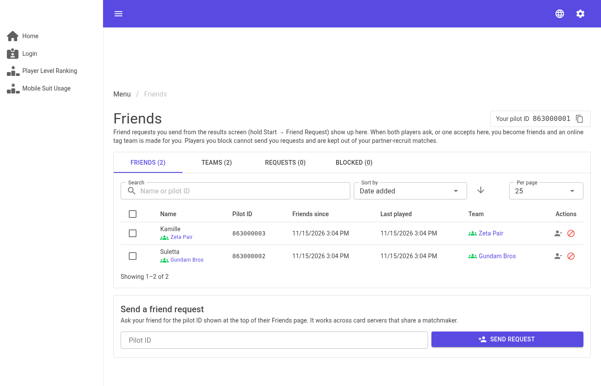
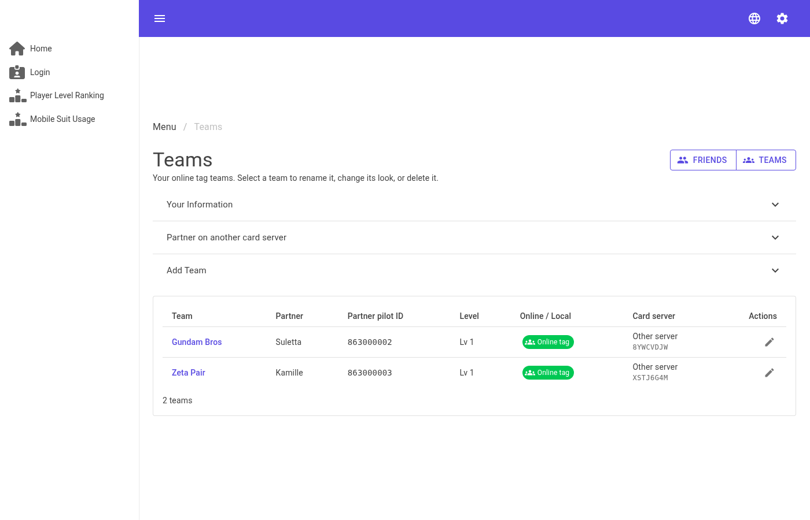
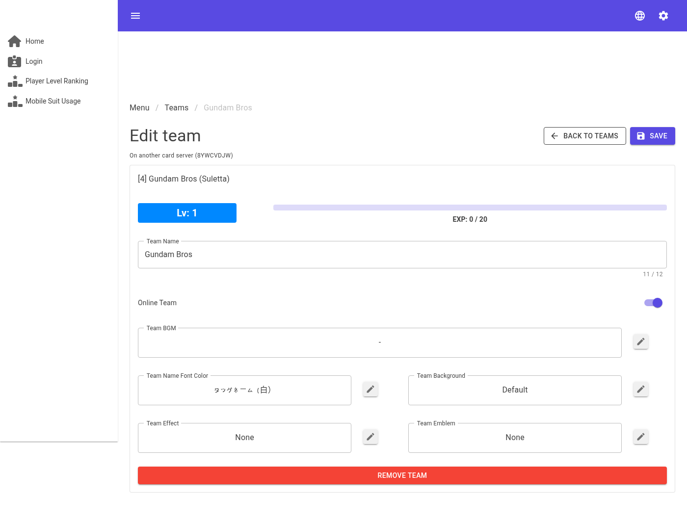

# exvs2-matchmaking

> ⚠️ **Experimental — work in progress.**
>
> **2026-11-13: first real-game test.** Two cabinets on one PC queued online through the patched card server
> (`server-sketch/ib-server`), matched, and played full matches; results were saved. The results screen hangs
> after every 2-cabinet versus match on one PC (also without the matchmaker — see
> [the test report](analysis/real-game-test-2026-11-13.md)).
> **2026-11-15:** a second person's from-scratch card-server build paired in Online Tag and completed a
> 4-human Mix Match through a shared VPS matchmaker (two PCs, same house). A two-location NAT test is still
> pending. The Python MMS and the `server-sketch/csharp` handlers are still untested sketches.

> **2v2 matches only form with at least 4 human players.** With `NoCpuPartner` (default on), 2v2 modes never fill empty seats with CPU partners. Fewer than 4 searchers wait until each cabinet's own matching timeout (~150 s), then return to practice mode and can search again. Fes 1on1 (world 20) still needs only 2 players.


## ➡️ [Setup guide: host a matchmaking server / connect your cabinet](docs/SETUP.md)

## 🔒 [Security: access modes, the `/tag` shared secret, log masking, known risks](docs/SECURITY.md)

## 📦 [Download the pre-release server package (Windows + Linux)](https://github.com/ServerOmega/exvs2-matchmaking/releases) — build, configure and start with three double-clicks; hosting a public server (port forwarding / VPN / VPS): [`release/package/Public-Server.txt`](release/package/Public-Server.txt); card-website pictures from the official v1.2.0 release: [`release/package/Import-Pictures.txt`](release/package/Import-Pictures.txt)

**Goal: one universal matchmaking server that everyone connects to.** Players at a store with an LM, players
without an LM, and players at many different LMs all use the same server and can match each other wherever the
network allows. See [analysis/lm-and-online.md](analysis/lm-and-online.md).

See [TESTING.md](TESTING.md) for the checklist of things that still need a real-game test.

## Findings and cabinet exe patches (15–16 November 2026)

Cabinet tests from these two days — start order, Class vs Mix queues, pair search, official
cabinet behaviour, result saving, Class rate, and loading-phase disconnects — are in
[docs/findings-2026-11-15-16.md](docs/findings-2026-11-15-16.md).

A **draft** guide to the optional, privately distributed game-executable patches (pair
keep-searching and free-play no-game-over) is in
[docs/exe-patching-guide.md](docs/exe-patching-guide.md). Those patches, their scripts, and
any game executable are **not** in this repository. You must already own a legitimate copy
of the game.

Research and prototypes for a **universal online matchmaking server** for arcade
*Mobile Suit Gundam: Extreme Vs. 2 Infinite Boost* (EXVS2 IB).
The goal is a large shared player pool, beyond the Live Monitor (LM) store model's
16-terminal LAN limit.

This project builds on ideas from [asesidaa/EXVS2-POC](https://github.com/asesidaa/EXVS2-POC)
(community card/game server). It is **not affiliated with Bandai Namco**. No game files are
included. You must already have a copy of the game; this repo is notes, analysis, and server sketches only.

## Card website: Friends and Teams

The card server's web pages (screenshots use sample data).

| Friends | Teams | Edit team |
|---|---|---|
| [](docs/images/friends.png) | [](docs/images/teams-list.png) | [](docs/images/team-edit.png) |

- **Friends**: friend list with the team you share with each friend, requests, and block list.
- **Teams**: your online tag teams, plus adding a team and cross-server partner codes.
- **Edit team**: rename a team, change its look, or remove it.

## Current status

| Area | What's here | Works? |
|---|---|---|
| Research | `analysis/` — WAN/MMS + STUN protocol notes, LAN 16-slot limit, server design, [networking issues (Windows/NAT/VPN)](analysis/networking-issues.md), [LM + non-LM players on one server](analysis/lm-and-online.md), [LM over VPN, online over internet](analysis/lm-over-vpn-split.md), [partner invites / online tag](analysis/partner-invites.md) | Findings from static analysis; not proven in a live match |
| Python MMS sketch | `server-sketch/python/` — stdlib HTTP protobuf prototype + fake cabinets | Exercised against simulated cabinets only, **not** against the game |
| C# handler sketch | `server-sketch/csharp/` — IB-Server-style handlers + RegisterPcb notes | **Uncompiled**, not wired into a running server |
| Card server patch | `server-sketch/ib-server/` — patch for Chiang-17/EXVS2-IB-Server: RegisterPcb MATCH+STUN, in-process matchmaker, built-in STUN, IB class-match tables, ranked result storage, online tag (same-server invite or **cross-server partner code**) + partner recruit pairing, **NoCpuPartner** (4-human 2v2 rooms), **security hardening** (public allowlist, `/tag` shared secret, source-IP binding, rate limits, log masking — [docs/SECURITY.md](docs/SECURITY.md)) | Builds (Linux + win-x64), **251** unit tests pass; **real game: 2026-11-13 two cabinets on one PC; 2026-11-15 Fes 1on1 through the VPS matchmaker; 2026-11-15 5:57 AM PT cross-server online tag** (two card servers, shared `/tag` store, world-5 pair formed); **2026-11-15 7:33 AM PT four cabinets: two online-tag pairs (one cross-server, one same-server) formed 2v2 rooms and completed several games** with the security build; **2026-11-15 9:52 AM PT a second person's from-scratch build** paired in Online Tag and completed a 4-human Mix Match through the VPS (same house) ([TESTING.md](TESTING.md#from-scratch-build-and-same-house-vps-test-2026-11-15)) ([report](analysis/real-game-test-2026-11-13.md)) |
| Real-game test | [`analysis/real-game-test-2026-11-13.md`](analysis/real-game-test-2026-11-13.md) — results, fixes, results-screen hang investigation, two-cabinets-on-one-PC recipe | Two cabinets on one PC only |
| Load test | `server-sketch/loadtest/` — 100–500 simulated cabinets against both matchmakers ([results](analysis/load-test.md)) | Fake cabinets only; found and fixed 7 matchmaker bugs |
| STUN | `server-sketch/coturn/turnserver.conf` — STUN-only coturn example (TEST-NET placeholder IPs) | Config only; not deployed |
| RE tooling | `tools/re/` — Capstone/pefile scripts for xrefs and scans | Source only; the venv and `xrefs.pkl` cache are not in this repo |
| Project notes | `notes/README.md` — index of what's present, missing, and still open | Informal lab notes |

A copy of the game executable is **not** in this repository and must never be added.

## Key finding (confirmed in game 2026-11-13)

The WAN vs LAN switch is a **config change**, not an exe patch. If the active entry in
`testmode_pcb.json` has `battleMode: 0`, the client takes the WAN path: HTTP protobuf MMS
(rev 6) plus a standard RFC 5389/5780 STUN server. Any other `battleMode` stays on the
shop/LM LAN path (16 terminal slots).

This was read out of the client and **confirmed in the real game on 2026-11-13** (two cabinets queued online,
matched and played). Edit those testmode files only with the project's `svd1.py` tool,
and only on a backup you can restore. Do not use "EXIT & SAVE" in the test menu.

Other results, documented in `analysis/matchmaking.md`:

- The match server `uri` from RegisterPcb is used as the full MMS URL; the port field is ignored.
- A `SRV_STUN` entry is required to start STUN and `IssueNodeId`.
- `IssueNodeId` must return at least as many unique IDs as the game asked for (it asks for 2).
- `CheckMatching` must list all four players, including self; `group_id` is the team (2v2).
- The game accepts an MMS reply on HTTP 200 + `code == SUCCESS`; it does not verify request-id.
- A failed NAT test does not, on its own, block queue entry (falls back to type 3 or 4).
- P2P battles still need reachable UDP (public IP, UPnP, or a VPN).

## Layout

```
analysis/            Matchmaking research and the extracted MMS .proto
notes/               Lab index (kept as written; some older notes are still missing)
server-sketch/       Python prototype, C# sketch, coturn example, ib-server card-server patch
docs/SETUP.md        Step-by-step: hosting the server, connecting a cabinet, troubleshooting
docs/findings-2026-11-15-16.md  Cabinet-test findings from 15–16 November 2026
docs/exe-patching-guide.md      DRAFT guide to optional private game exe patches
tools/re/            Reverse-engineering helper scripts (no game binary, no caches)
```

## License

Copyright (C) 2026 ServerOmega.

The original work in this repository (scripts, tools, simulators, tests, the Python
prototype and C# sketches, docs, notes and analysis) is licensed under the
**GNU General Public License v3.0** — see [LICENSE](LICENSE).

**Not covered by this license:**

- **Chiang-17/EXVS2-IB-Server** (the card server) and any of its code. Upstream has no
  license; all rights remain with its author. Nothing from it is relicensed here.
- **`server-sketch/ib-server/online-matchmaking.patch`**,
  **`release/package/files/online-matchmaking.patch`**, and the follow-on series
  **`server-sketch/ib-server/results-gap-and-rolling-fill/`**. These patches contain upstream
  context lines and only make sense applied to the card server above, so they are
  excluded from the GPL grant and offered as-is for personal use against your own copy.
- **The game, its data, images and trademarks** (Bandai Namco / Sunrise). None of these
  are included in this repository.
